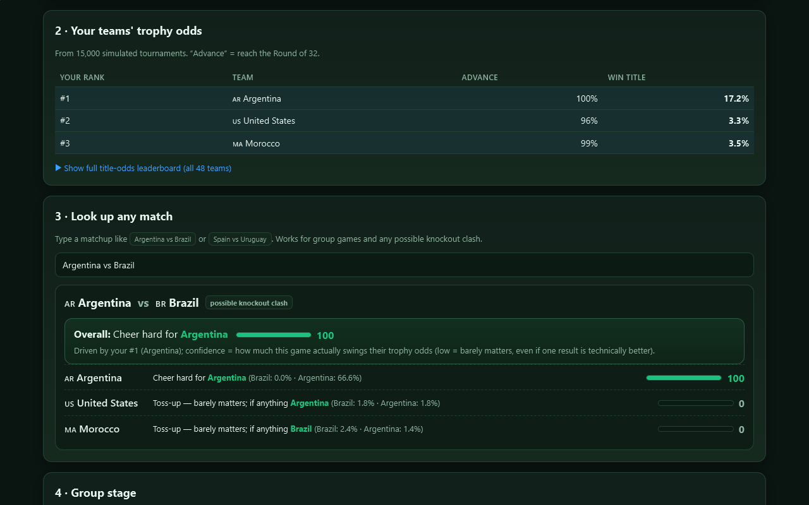
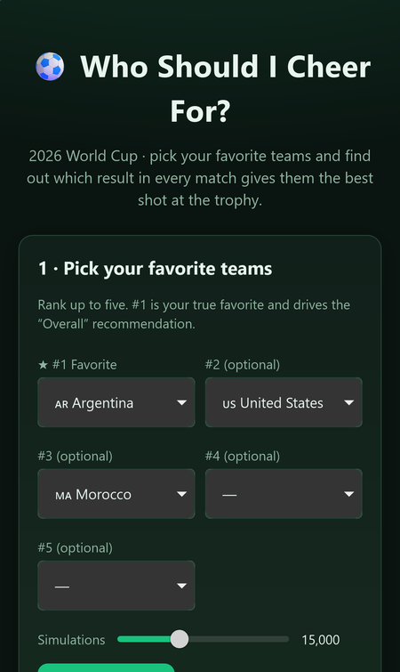
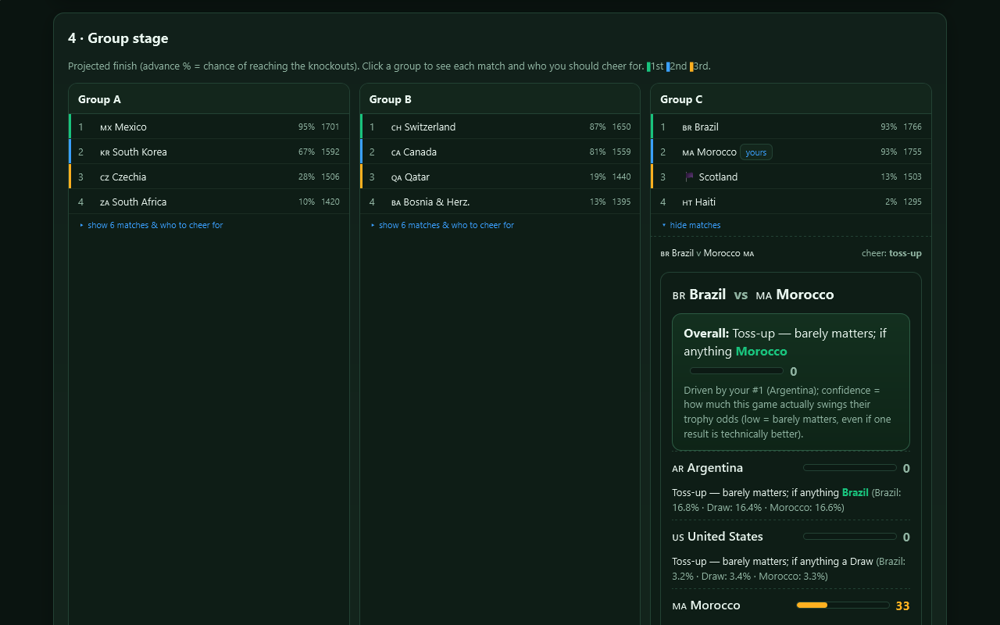

# Who Should I Cheer For?

Pick your favorite teams for the 2026 World Cup, and this simulates the whole tournament thousands of times to tell you which result in every match gives them the best shot at the trophy.

**[▶ Open the live app](https://timothyhadfield.github.io/world-cup-preference/)** · works on phone and laptop

  
  &nbsp;
  

  

## Features
- **Rank up to five favorites**: your #1 drives the overall advice, the rest are weighed in behind it
- **Monte-Carlo simulation**: 2,000–40,000 full tournaments (you pick), from Elo ratings, with a home-field bonus for the three hosts
- **Trophy odds**: each favorite's chance to reach the knockouts and to win it all, plus a leaderboard for all 48 teams
- **Look up any match**: type "Argentina vs Brazil" to see which result helps your teams, whether it's a group game or a possible knockout clash
- **Confidence scores**: how much a match actually swings your odds, with simulation noise stripped out, so a game that barely matters says so
- **Group stage and projected bracket**: projected finishes for all 12 groups, who to cheer for in each group game, and the most likely knockout path

## Built with
A single HTML file with plain JavaScript. Ratings from [World Football Elo](https://www.eloratings.net/) (June 2026). An entertainment tool, not betting advice.
